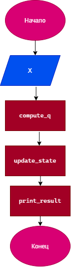

# Курсовой проект «Мониторинг технологического процесса»

Денисова С.В. бИЦТ-261 Вариант А21

## Цель работы
Разработать программу на языке C, моделирующую цифровой двойник
технологического процесса по данным, поступающим от датчика. Программа
последовательно получает показания датчика, преобразует их в индикатор
состояния процесса Q, выполняет оперативный контроль и затем проводит
статистический анализ накопленного массива.

## Постановка задачи
Датчик технологической установки работает непрерывно и формирует
последовательность показаний X₁, X₂, …, Xₙ. (В программной реализации -
показания последовательно считываются из файла). Каждое показание
преобразуется по индивидуальной кусочной функции в индикатор технологического
процесса: `Qᵢ = f(Xᵢ)`
Контроль выполняется непосредственно при поступлении нового значения `Qᵢ`.


## Входные данные
X (температура) — в градусах Цельсия (°C), . 
Значения X поступают с датчика. Значение должно быть больше или равно нулю.

## Формула Q

$$
Q(x) = 
\begin{cases} 
1.5x + 10, & x < 100 \\
0.8x + 80, & 100 \le x < 200 \\
0.4x + 160, & x \ge 200 
\end{cases}
$$


## Ручной расчет Q для трёх значений X
1. Пусть X = 50:
   Q(50) = 1.5 * 50 + 10 = 75 + 10 = 85
2. Пусть X = 150:
   Q(150) = 0.8 * 150 + 80 = 120 + 80 = 200
3. Пусть X = 250:
   Q(250) = 0.4 * 250 + 160 = 100 + 160 = 260

## Блок-схемa



## Каркас программы
```C++
#include <stdio.h>
#include <locale.h>

#define Q0 220.0
#define SMAX 500.0

// Прототипы функций 
double read_value(void);              // чтение одного X
double compute_q(double x);           // расчёт Q по формуле
int update_state(double q, int current_state); // контроль/переход состояний 
void print_result(double x, double q, int state); // вывод 

// Статистика
void calc_statistics(double q_array[], int size);

int main() {
    setlocale(LC_CTYPE, "RUS");
    printf("Каркас программы\n");

    // Чтение
    double x = read_value();
    printf("Считано X = %.2f\n", x);

    // Расчет
    double q = compute_q(x);
    printf("Рассчитано Q = %.2f\n", q);

    // Контроль 
    int state = update_state(q, 0);

    // Вывод
    print_result(x, q, state);

    // Статистика (ориентируемся на ручной расчет)
    double test_q[] = { 85.0, 200.0, 260.0 };
    calc_statistics(test_q, 3);

    return 0;
}

// Каркас: чтение X
double read_value(void) {
    // Возвращаем фиксированное число (позже будет ввод)
    return 150.0;
}

// Расчёт Q 
double compute_q(double x) {
    if (x < 100.0) {
        return 1.5 * x + 10.0;
    }
    else if (x >= 100.0 && x < 200.0) {
        return 0.8 * x + 80.0;
    }
    else {
        return 0.4 * x + 160.0;
    }
}

// Каркас: контроль/переход состояний
int update_state(double q, int current_state) {
    return current_state;
}

// Каркас: вывод результата
void print_result(double x, double q, int state) {
    setlocale(LC_CTYPE, "RUS");
    // Вывод
    printf("Результат: X=%.2f, Q=%.2f, Состояние=%d \n", x, q, state);
}

// Каркас: статистика
void calc_statistics(double q_array[], int size) {
    setlocale(LC_CTYPE, "RUS");
    // Расчет среднего, мин, макс, среднего квадратов
    printf("Статистика: Получен массив из %d элементов\n", size);
}
```
